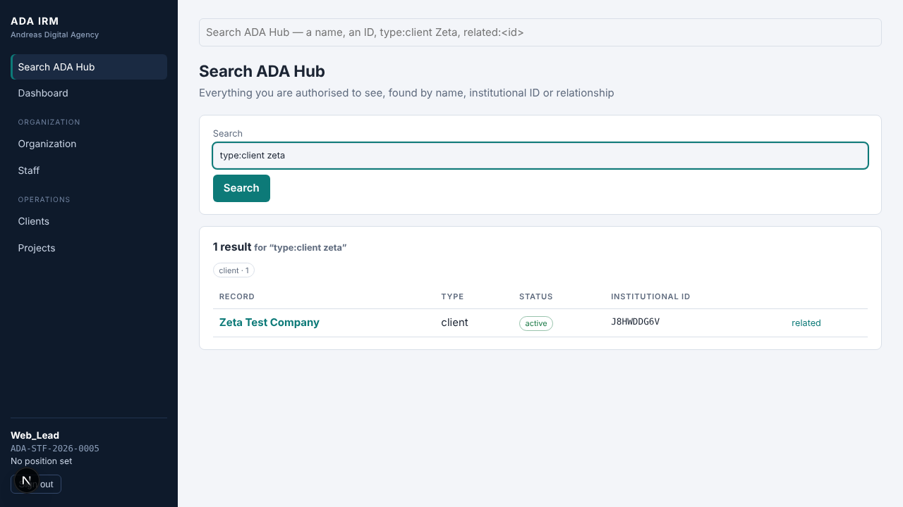

# ADA Hub Pilot V0.1 — Operational Map

> **Status:** the operational map (sections A–C, written first from the migrations 0001–0041, the test suites and the `web/` scaffold) **plus what the pilot then built and proved (sections D–H)**. Pilot V0.1 is complete and waiting for approval; nothing beyond it (dashboards, reporting) has been started.
> **Scope rule:** completed modules (Documents, Organizations, Domains, Communications, Search, Assets, Finance, Tickets) are closed. This map records what they already offer so the pilot *calls* them; it does not propose changing them.

## 0. Headline finding

**The backend could already run the whole engagement, and now it has been shown to.** Every step of Workflow A had a controlled, authorized, audited database function; the 360 views already carried the cross-module slices. What was missing, and is now built:

1. **An interface** (the `web/` scaffold had login, dashboard, organization and staff only). Search is now the front door; Client 360, Project 360, quote, contract and invoice pages and four "attach" forms exist (section D).
2. **One scenario joining every module**, with restricted-user probes across all of it: `110_ada_hub_pilot.sql` (42 checks) and `111_ada_hub_pilot_access_restricted.sql` (25 checks), plus a pilot concurrency block.
3. **One real defect**, found by that scenario and fixed in `0042_pilot_project_360.sql`: Project 360 did not show invoices billed through a contract, and had no payments slice (finding F1).

Everything else was reused as it was. No table was added. No completed module's architecture changed.

Baseline before any pilot work: `./scripts/test-db.sh` on PostgreSQL 16 — 2,760 checks, 0 failed. After the pilot: 2,827 checks, 0 failed, plus all concurrency scripts (section G).

---

## A. Existing authoritative modules

Conventions that hold for every row below:

- **Institutional ID** = 9-char opaque ID minted by `ada_mint_id` and held in `entity_registry` (`institutional_id`, `table_name`, `entity_id`). Legacy `ada_id` (e.g. `ADA-CLI-…`) is an alias kept on most tables.
- **Authorization** = RLS on the table plus a `can_view_*` / `can_edit_*` helper plus a `has_permission(key, division)` check inside every `SECURITY DEFINER` workflow function. Restricted rows look like missing rows (`85_existence_leakage.sql` and the per-module `*_restricted` suites).
- **Audit** = `audit_log` via `audit_row()` triggers (immutable), plus per-module event tables (`ticket_events`, `asset_history`, `document_events`, `domain_events`, `communication_events`, `contract_status_history`).

| # | Module | Authoritative table(s) | Registry type | Controlled write functions (use these, never the table) | Read / 360 | Lifecycle |
|---|---|---|---|---|---|---|
| 1 | **Organization** (identity of any company) | `organizations` (+ `partners`; role rows `clients`, `suppliers`) | organization | `organization_create`, `organization_add_role`, `organization_update`, `organization_set_classification`, `org_match` (matching), `organization_merge`, `organization_review_resolve` | `organization_360`, `can_view_organization` | status derived from roles (`org_derived_status`); reviews for ambiguous matches |
| 2 | **Client** (role of an organization) | `clients`, `client_divisions`, `client_staff`, `client_contacts` | client | `client_lookup`, `client_create` (searches first, routes ambiguity to `matching_reviews`), `claim_client_for_division`, `set_client_owner`, `matching_resolve` | `client_360` | active/inactive; never duplicated across divisions |
| 3 | **Person / contact** | `people`; relationship rows `client_contacts`, `project_contacts`, `applications`, `leads` | person | `add_client_contact` (creates or reuses the `people` row), `lead_set_person`; `can_view_person` / `can_edit_person` | inside `client_360.contacts` | one `people` row per human; relationships are separate rows |
| 4 | **Division / staff / roles** | `divisions`, `staff`, `roles`, `permissions`, `role_permissions`, `staff_roles`, `staff_assignments` | staff, division | `link_staff_account`, onboarding functions | `staff_360`, `my_access()` | staff status incl. suspended (no access) |
| 5 | **Services & prices** | `services`, `service_prices` (immutable versions) | service | `price_propose`, `price_decide`, `price_withdraw`, `service_transition`, `price_on(service, date)` | `can_view_service` | prices are append-only versions; approval queue |
| 6 | **Enquiries & leads** | `enquiries`, `leads`, `enquiry_candidates`, `matching_reviews` | lead | `enquiry_process`, `enquiry_resolve_candidate`, `lead_assign`, `lead_transition`, `quote_create_from_lead` | inside `client_360.leads` | enquiry → lead → qualified → quote |
| 7 | **Quotes** | `quotes`, `quote_lines` (price snapshot: `unit_price`, `price_id`) | quote | `quote_create`, `quote_add_line` (resolves current approved price from the catalogue), `quote_remove_line`, `quote_transition` (draft → pending_approval → approved → sent → accepted/rejected/expired; calls `approval_gate`), `quote_convert_to_project` (idempotent, creates `project_services` carrying the quote line + price id) | `can_view_quote`, inside `client_360.quotes` / `project_360.quotes` | transition table; lines lock after submission |
| 8 | **Approvals** | `approval_requests`, `approval_policies`, `approval_decisions` | — | `approval_gate`, `approval_open`, `approval_close`, `approval_policy`, `qualified_approver_count` (self-approval only when the requester is the sole qualified approver) | one approvals queue | pending → approved/rejected |
| 9 | **Projects** | `projects`, `project_services`, `project_divisions`, `project_members`, `project_contacts`, `milestones`, `tasks`, `portfolio_entries`, `project_financials` | project | `project_transition`, `project_add_service`, `project_lead_division`, `quote_convert_to_project`; **no create / add-contact / add-member / add-task function** (direct inserts under RLS + `projects_guard` — see §B) | `project_360`, `can_view_project`, `has_project_permission` | proposed → approved → active → … (guard rejects direct status change) |
| 10 | **Contracts** | `contracts`, `contract_versions`, `contract_lines`, `contract_projects`, `contract_status_history` | contract | `contract_create`, `contract_create_from_quote`, `contract_set_terms`, `contract_link_project`, `contract_transition`, `contract_amend`, `contract_renew`, `contract_terms` | `contract_load`, inside `client_360.contracts` | draft → … → active → expired/renewed; versions immutable once signed |
| 11 | **Invoices** | `billable_items`, `invoices`, `invoice_lines` (snapshots), `finance_settings` | invoice | `billable_from_contract`, `billable_from_project`, `billable_void`, `invoice_create`, `invoice_add_lines`, `invoice_set_terms`, `invoice_transition` (approval gate), `invoice_void`; `invoice_balance` / `invoice_paid` are derived functions | `invoice_load` | draft → issued → partially_paid/paid; immutable after issue |
| 12 | **Payments** | `payments`, `payment_allocations`, `payment_reversals`, `bank_accounts` | payment | `payment_record`, `payment_allocate`, `payment_unallocate`, `payment_request_reversal`, `payment_reversal_decide`, `payment_reconcile`; views `invoice_balances`, `payment_balances` | `payment_load` | received → allocated; reversals via approval |
| 13 | **Documents** | `documents`, `document_versions`, `document_links`, `document_access`, `document_holds` … | document | `document_register`, `document_add_version`, `document_version_transition`, `document_link_add(doc, entity)`, `document_open`, `document_share`, `document_hold_place`, `document_archive` … | `document_360`, `documents_of(ids)`, `documents_for_entity` | version states; retention classes; legal holds; publication gate |
| 14 | **Communications** | `communication_threads`, `communication_messages`, `communication_participants`, `communication_links`, `communication_attachments`, `communication_access` … | communication | `communication_start`, `communication_message_record`, `communication_link_add(thread, entity)`, `communication_read` (body access, separate permission), `communication_attach_document` … | `communication_360`, `communications_of(ids)` (**metadata only**) | open/closed/archived; holds; disposal |
| 15 | **Domains** | `domains`, `domain_relations`, `domain_registrations`, `domain_transfers` … | domain | `domain_create`, `domain_activate`, `domain_renew`, `domain_relation_apply(domain, relation, entity)`, `domain_transfer_*` | `domain_360`, `domains_of(ids)` | registered → active → expired/transferred |
| 16 | **Assets** | `assets`, `asset_assignments`, `asset_history`, `asset_maintenance`, `asset_warranties`, `asset_finance_links` … | asset | `asset_create(…, p_client, p_project)`, `asset_assign(…, p_project)`, `asset_update`, `asset_transition`, `asset_link_finance`, `maintenance_*`, `asset_retire` | `asset_360`, `asset_current_assignments` | proposed → in stock → assigned → … → retired → disposed; ID permanent |
| 17 | **Tickets** | `tickets`, `ticket_categories`, `ticket_sla_policies`, `ticket_comments`, `ticket_events` | ticket | `ticket_create(…, p_asset, p_client, p_project, p_contact, …)` (inherits client/project from the asset), `ticket_assign`, `ticket_transition`, `ticket_comment_add`, `ticket_set_priority`, `ticket_transfer` | `ticket_load`, view `ticket_sla_status` | open → … → closed; SLA clock |
| 18 | **Search** | `search_index` (derived), `search_sources`, `search_refresh_queue` | — | `search(query, limit, offset, facets)`, `search_suggest(prefix, types, limit)`, `search_parse`, `search_capabilities`; filters `type:` `status:` `division:` `related:ID` `asof:` `limit:`; bare institutional / legacy ID is an exact lookup. Derived and rebuildable (`search_rebuild`) | staff only | stale rows re-checked against live authorization |
| 19 | **Registry resolution** | `entity_registry` | all | `entity_resolve(id)`, `entity_get(id)`, `search_route(query)` | — | IDs never reused or re-encoded |

### A.1 What the 360 views already return

`client_360(client)` → organization (+ roles), overview, contacts, relationship (divisions, services purchased), projects, quotes, leads, quote_summary, activity (last 25 audit rows for the client, contacts and divisions), contracts, invoices (with derived `paid` / `balance`), payments, finance_summary (invoiced / paid / outstanding / overdue / unallocated credit), assets, tickets, documents, domains, communications, `pending`.

`project_360(project)` → overview, client, contacts, divisions, services, quotes, staff, milestones, tasks, budget, portfolio, activity, contracts, invoices, assets, tickets, documents, domains, communications, `pending`.

Both are `SECURITY INVOKER` and return `null` for a row the caller cannot see. Documents / domains / communications slices go through `documents_of` / `domains_of` / `communications_of`, which apply each module's own authorization (communications give **metadata only**).

Observations to check during the pilot (do not "fix" in advance):
- `project_360` lists `'staff'` but I did not confirm in this pass that it includes payments. `client_360` carries payments; whether `project_360` should is a pilot-time question, since payments are linked to invoices rather than projects.
- `client_360.activity` covers `clients`, `client_contacts`, `client_divisions` audit rows only. "Complete institutional history" for the pilot means this plus the per-module event tables, and the pilot should say so on screen rather than imply one merged log.

### A.2 How a client of the database authenticates today

`web/` uses `@supabase/ssr`; `lib/access.ts` calls `rpc('my_access')`; `middleware.ts` guards routes. Every database call in the pilot UI should be a `supabase.rpc(<controlled function>)` or a `select` on a view / table under the signed-in user's own session. No service-role key in the browser or in server actions.

---

## B. Existing gaps

### B.1 REQUIRED FOR PILOT

| # | Gap | Why it blocks the workflow | Proposed minimal fix |
|---|---|---|---|
| R1 | **No UI beyond login / dashboard / organization / staff** | Nothing in the journey can be done without SQL | Minimal internal screens: search (entry point), organization/client create-or-reuse, client 360, project 360, quote, invoice, payment, and "attach / record / raise" forms for document, communication, ticket, asset |
| R2 | **No end-to-end test** joining all modules, and no restricted-access suite across the whole chain | The definition of done requires the Zeta scenario and leakage proofs across Client 360, Project 360, search, facets, suggest and traversal | `110_ada_hub_pilot.sql`, `111_ada_hub_pilot_access_restricted.sql`, plus a pilot concurrency script |
| R3 | **Projects have no controlled create path.** Standalone projects are direct `INSERT`s under RLS; `quote_convert_to_project` is the only function that creates one. `project_contacts`, `project_divisions`, `project_members`, `tasks`, `milestones` are also direct-write (granted to `authenticated`) | Section 23 says the UI must not mutate protected tables. Journey step 4 ("create website project") may start before a quote | Thin `SECURITY DEFINER` wrappers over the existing guards: `project_create`, `project_add_contact`, `project_add_division`, `project_add_member`, `task_create`. They add no tables. They call the same permission checks the guards use and write the same audit rows |
| R4 | **Organization → client "create or reuse" is split across `org_match`, `organization_create`, `client_create`, `organization_add_role`** | The UI must make "ABC — Web" and "ABC — Tech" impossible. `client_create` already searches first and routes ambiguity to review, so the UI can call it directly. Confirm in the pilot suite that one call covers organization + client role + originating division, and wrap only if it does not | Prefer calling `client_create` as is. Add a wrapper only if the suite shows a gap |
| R5 | **Search → record navigation.** `search()` returns results; the UI needs a stable result → page mapping by entity type | Search must be the entry point | Pure UI routing table keyed on result `entity_type` and institutional ID. No database change |
| R6 | **A single "who am I / what can I do" call per screen** to hide actions the user can't perform | UI must show authorization state without inventing a second authorization system | Reuse `my_access()`. Actions still fail closed in the database |
| R7 | **A pilot seed / fixture** for the Zeta scenario: users A, B, C and a suspended user, with roles and division assignments, plus a service with an approved price | Needed to demonstrate the journey and for the tests | Test-only fixture in the pilot suites. A documented, repeatable dev seed for the manual demo, kept out of `migrations/` |

### B.2 NICE TO HAVE (only if cheap once R1–R7 are done)

- Show `approval_requests` state inline on quote / invoice pages (the queue exists).
- `related:` search shortcut button on every 360 page.
- Merged chronological timeline per client from `audit_log` plus module event tables (read-only view or UI composition).
- A payments slice in `project_360`, if the pilot shows people expect it.

### B.3 FUTURE (do not build in this phase)

Dashboards and reporting; public API HTTP layer; public search; publication layer; expenses and credit notes; recurring invoicing; client merge UI; email / WhatsApp / SMS; external document sharing; saved searches and search analytics; AI interpreter, semantic or vector search; MFA and rate limiting; staging run on a real Supabase project (recommended but separate).

### B.4 Baseline: one intermittent concurrency failure (not reproduced)

The first baseline run printed `FAIL concurrent search: got 160,0,true,0 with 1 failed statements` (the data assertions held; exactly one parallel statement errored). The second full run passed everything. The test script discards the statement's error text, so the cause was unknown. I looped that exact block 16 times (8 of them with 4 busy CPU loops on the machine) with stderr captured: **0 failed statements in 16 rounds**. It is recorded as an unexplained, unreproduced one-off. Search was not changed. If it recurs, the harness in the git history of this section (the loop that keeps stderr) is the way to get the message.

---

## C. Workflow map — Workflow A "New client engagement"

Each step names the **controlled operation** the interface calls. "Needs" = permission checked inside the function. Everything after "Audit" is written by the database, not the UI.

| # | Step | UI action | Controlled operation | Needs | Reuses / guarantees | Audit / history |
|---|---|---|---|---|---|---|
| 1 | Authenticate | Sign in | Supabase Auth → `my_access()` | active staff | suspended staff get no access | session |
| 2 | Search | Type `Zeta`, `type:client Zeta`, `related:<id>`, or a bare ID | `search()`, `search_suggest()`, `search_route()` | staff | results re-checked against live authorization; restricted rows absent from results, counts and facets | none (search is not logged in V0.1) |
| 3 | Find or create organization | "New client" form first calls the match; shows candidates; offers *use this one* | `client_lookup` / `org_match`; then `client_create` | `clients.create` in the originating division | exact / strong match reuses the record; ambiguous → `matching_reviews`; restricted matches behave as "no match" without leaking | `audit_log`, registry row, review row if ambiguous |
| 4 | Client relationship | Implicit in step 3, or *claim for my division* on an existing client | `client_create` (originating division) / `claim_client_for_division` | division permission | one `clients` row, many `client_divisions` | `audit_log` |
| 5 | Client contact | "Add contact" | `add_client_contact` | `can_edit_client` | reuses an existing `people` row on match; contact is a relationship row | `audit_log` |
| 6 | Project | "New project" under the client | `project_create` (**new thin wrapper, R3**) | `projects.create` in division | `projects_guard` rules; starts as `proposed` | `audit_log`, registry |
| 7 | Division + service | Pick lead division; pick service | `project_lead_division`, `project_add_service` (price from `price_on`) | `projects.update` | price version recorded on the line | `audit_log` |
| 8 | Quote | "New quote", add lines from catalogue | `quote_create`, `quote_add_line` | `quotes.create` | unit price snapshotted with `price_id`; later price changes do not touch it | `audit_log` |
| 9 | Approval | Submit; approver decides | `quote_transition(→pending_approval)`, then `→approved` | quote approve permission; separation of duties via `approval_gate` | self-approval only if sole qualified approver | `approval_requests` / `approval_decisions` |
| 10 | Accept | Mark sent, then accepted | `quote_transition(→sent)`, `→accepted` | quotes permission | accepted quote locked | `audit_log` |
| 11 | Project / contract link | "Convert" and "Create contract" | `quote_convert_to_project` (or link to the project from step 6), `contract_create_from_quote`, `contract_link_project`, `contract_transition` | `projects.create/update`, `contracts.*` | idempotent conversion; contract lines copy the quote snapshot | `contract_status_history`, `audit_log` |
| 12 | Invoice | Pick billable items → create → issue | `billable_from_contract` / `billable_from_project`, `invoice_create`, `invoice_transition(→issued)` | `invoices.*`, approval gate | line and client snapshots; immutable after issue | `audit_log`, approvals |
| 13 | Payment | Record, allocate (partial) | `payment_record`, `payment_allocate` | `payments.*` | balance is derived (`invoice_balance`); no stored balance | `audit_log` |
| 14 | Document | Upload / register and link to client or project | `document_register`, `document_add_version`, `document_link_add` | `documents.*` | classification, retention, holds apply | `document_events` |
| 15 | Communication | Record a thread/message and link | `communication_start`, `communication_message_record`, `communication_link_add` | `communications.*` | 360 shows metadata only; body needs `communications.read` | `communication_events` |
| 16 | Ticket | Raise from client or project | `ticket_create(p_client, p_project, p_asset…)` | `tickets.create` | no copied identity; inherits from asset | `ticket_events` |
| 17 | Asset | Register / assign to the project | `asset_create` or `asset_assign(p_project)` | `assets.*` | permanent institutional ID survives moves | `asset_history` |
| 18 | Domain (optional) | Register / link | `domain_create`, `domain_relation_apply` | `domains.*` | | `domain_events` |
| 19 | Inspect | Open Client 360 / Project 360 | `client_360`, `project_360` | view permissions | `null` for rows the caller cannot see | `activity` slice plus module event tables |
| 20 | Re-find | Search `Zeta`, ID, `related:<id>` | `search()` | staff | every created record present | — |

### C.1 Pilot test identities

| Identity | Scope | Must be able to | Must not be able to |
|---|---|---|---|
| **User A** | manages the Zeta client and project (Web division) | complete steps 1–20 | — |
| **User B** | another division, no access to the restricted records | search and view own division; see Zeta only where legitimately shared | see restricted clients / projects / documents / communications, or learn they exist (search, facets, suggest, 360, errors, traversal) |
| **User C** | insufficient permissions | sign in, view what is granted | any create / approve / issue / pay action |
| **Suspended / anonymous** | none | nothing | everything |

### C.2 Test plan (summary; full suites come with the build)

- `110_ada_hub_pilot.sql` — identity (no duplicate organization / person / client role), the full chain with relationship checks to every module, immutability (historical price, issued invoice), stable IDs, search finds each created record and `related:` traverses.
- `111_ada_hub_pilot_access_restricted.sql` — probes comparing a restricted id with a random id for Client 360, Project 360, search, suggest, facets, counts and `related:`, as Users B, C and suspended.
- `concurrency/pilot_setup.sql` + a block in `test-db.sh` — racing `client_create` of one name, racing project/contract creation from one accepted quote, racing `invoice_create` over the same billable items, racing `payment_allocate`.

### C.3 What happened to the plan

Every step in the original plan was done in order, except that the "thin wrappers" for project writes (R3) were deliberately **not** built (finding F5), and R4 needed no wrapper (`client_create` already does it).

---

## D. What was built

| Piece | Where | Notes |
|---|---|---|
| Zeta engagement suite | `supabase/tests/110_ada_hub_pilot.sql` | search → organization/client → contact → project → service price → quote → approval → acceptance → contract → invoice → payment → document → communication → ticket → asset → domain → Client/Project 360 → search again; identity, immutability, stable-ID checks |
| Restricted-workflow suite | `supabase/tests/111_ada_hub_pilot_access_restricted.sql` | users A (manages), B (other division), C (same division, too few permissions), suspended, outsider, anonymous; a restricted engagement beside the visible one; differential and "hidden id = random id" probes |
| Pilot concurrency | `supabase/tests/concurrency/pilot_setup.sql` + a block in `scripts/test-db.sh` | races on organization/client, contact, quote conversion, contract creation, invoicing |
| Migration | `supabase/migrations/0042_pilot_project_360.sql` | **read side only**: `project_360` adds contract invoices and a derived payments slice. No table, column, grant or policy change |
| Interface | `web/app/(irm)/…`, `web/components/panels.tsx`, `web/lib/db.ts` | search, record resolver, clients, projects, quote, contract, invoice, generic record pages (ticket, asset, document, thread, domain…) |
| Interface ↔ database check | `scripts/check-web-db.mjs` (run by `test-db.sh`) | every function, argument, table and column the interface uses exists in the migrated schema; mutation-checked |
| Live harness | `scripts/pilot-live/` | runs the Zeta journey through the real interface against the real database with no Supabase account (PostgREST + a local auth stand-in + headless Chromium). A dev harness, not CI |
| Protected checks | `supabase/tests/PROTECTED.txt` | 14 new phrases; `check-protected-tests.mjs` also requires `concurrent_pilot` and `check-web-db.mjs` in the runner |

### D.1 Interface pages

| Page | What it is | Calls (all under the signed-in user's session) |
|---|---|---|
| `/search` | the front door; also a search box on every page | `search`, `search_suggest` |
| `/r/<any id>` | resolver for any institutional or legacy ID; "not found" and "not allowed" look the same | `entity_resolve` |
| `/clients`, `/clients/new` | list; **check-then-create** so a duplicate organization is hard to make | `client_lookup`, `client_create` |
| `/clients/<id>` | **Client 360**; add contact, join from another division, new project, new quote, record payment, attach | `client_360`, `add_client_contact`, `claim_client_for_division`, `quote_create`, `payment_record` |
| `/projects`, `/projects/<id>` | **Project 360**; status moves, add service at today's catalogue price, attach | `project_360`, `project_transition`, `project_add_service` |
| `/quotes/<id>` | lines from the catalogue (price copied), approval trail, status moves, convert to project, create contract | `quote_add_line`, `quote_transition`, `quote_convert_to_project`, `contract_create_from_quote` |
| `/contracts/<id>` | status moves, covered projects, bill a line | `contract_transition`, `contract_link_project`, `billable_from_contract`, `invoice_create` |
| `/invoices/<id>` | derived paid / balance, status moves, allocate a payment | `invoice_transition`, `invoice_balance`, `invoice_paid`, `payment_allocate` |
| `/e/<id>` | generic record page; ticket moves and comments; assign an asset to a project | `ticket_transition`, `ticket_comment_add`, `asset_assign` |
| Attach panel (client and project pages) | document, communication, ticket, asset | `document_register` + `document_link_add`, `communication_start` + `communication_message_add` + `communication_link_add`, `ticket_create`, `asset_create` |

The only write that is not a named function is **project creation**, a guarded `INSERT` under row-level security (finding F5). The existing staff page already works the same way.

---

## E. Findings

| # | Finding | Action |
|---|---|---|
| **F1** | **Defect.** Project 360 showed a contract but none of its invoices (a project covered by a signed or active contract can only be billed through the contract, and such invoices carry the contract, not the project) and had no payments slice, although the brief puts Payments in Project 360. Caught by check 31 of `110`, which failed before the fix. | Fixed in `0042` (read side). A contract covering several projects shows its invoices on each of them. |
| **F2** | **Documentation / scope gap.** Invoices and payments are not Search sources, although `SEARCH.md` says `related:` reaches "invoices". `related:<client id>` returns projects, contracts, quotes, tickets, assets, documents, domains and communications, not invoices. | **Not changed** (Search is closed). Invoices and payments are reached through Client 360, Project 360 and the contract page. `110` records the limit. **Decision for you:** index them (and how: label only?), or correct `SEARCH.md`. |
| **F3** | Interface gap found by the live run: a contract needs a client contact ("an authorised contact is required"), but the new-quote form had no contact field. | Fixed in the interface: the quote form takes a contact (the primary one by default) and the quote page shows it. |
| **F4** | By design, not a defect: someone who cannot see a restricted client and creates a company with the same name gets an ordinary success and a **separate** organization; only a cleared reviewer sees the resulting duplicate review. This is the existing "restricted records look like missing records" trade-off. | Documented; `111` asserts both halves. |
| **F5** | Projects (and project contacts, members, tasks) have no `project_create` / `…_add` functions. They are written by guarded inserts under row-level security (the guard trigger and audit apply). | **Not changed**: wrappers would add code without adding a rule. The interface uses the same insert path. Say so if you want wrappers. |
| **F6** | `client_lookup` returns nothing for restricted clients even to management; cleared staff find them with Search. | Documented. |
| **F7** | `communications.read` is granted to division staff by the permission matrix, so a same-division staff member can read bodies; client visibility alone never does. `111` proves this against finance (which lacks the permission). | Documented. |
| **F8** | `concurrent_search` failed once in the baseline and not again in 18 further runs (section B.4). | Recorded; Search untouched. |

---

## F. Manual demonstration (Zeta Test Company) in the interface

Sign in as the person named; each step is one screen. (The live harness does exactly this and passes: section H.)

1. **web_lead** — `Search` for `zeta`: 0 results. Open **Clients → New client**, type `Zeta Test Company`: "No existing client found". Choose *ADA Web*, registration `ZTC-2026`, **Create**. You land on **Client 360**; the organization has its own institutional ID.
2. **tech_lead** — `Clients → New client`, same name: Tech sees ADA already knows the company, and can only open it or join it from the client page; no second organization is possible.
3. **web_lead** — on Client 360: **Add a contact** (Zoe Zeta, primary). **Create a project** (Zeta Website, lead division ADA Web): status *proposed*.
4. **web_lead** — **New quote** (contact Zoe, project Zeta Website). On the quote, **Add line**: *Website Development* at the approved catalogue price (5,000), copied into the quote with its price version. **Pending approval**. Try **Approved** yourself: refused (the requester cannot approve).
5. **ceo** — open the quote, **Approved**. Later changes to the catalogue price never alter this quote.
6. **web_lead** — **Sent**, **Accepted**, then **Link quote to its project** (the project now carries the priced service) and **Create contract from this quote**. On the contract: **Internal review**.
7. **ceo** — contract **Approved**. **web_lead** — **Sent**, **Signed**, **Active**; the contract lists the project it covers.
8. **fin** — on the contract, **Bill this line**: a draft invoice (5,000 + 15% VAT = 5,750). **Pending approval**; **ceo** approves; **fin** **Issued** (client name and VAT number are snapshotted; the invoice can no longer be edited).
9. **fin** — on Client 360, **Record a payment** of 2,000 against that invoice. The invoice now shows paid 2,000, balance 3,750, *partially paid* (derived, never stored).
10. **web_lead** — on Project 360, **Attach**: register a document, record a communication (its body is kept but never shown on client or project pages), register an asset, raise a ticket. Open the ticket or asset: *Related records* and the generic record page.
11. **Client 360 / Project 360** now show organization, contacts, projects, quotes, contracts, invoices, payments, services, assets, tickets, documents, domains and communication **metadata**, with the derived finance summary.
12. **Search** `zeta`, `type:client zeta`, an institutional ID, and `related:<id>`; every record resolves through `/r/<id>`. **tech_staff** searching `zeta`, or opening the Zeta client URL, sees nothing.

---

## G. Verification

| What | Result |
|---|---|
| `./scripts/test-db.sh` (all numbered suites, protected-check guard, all concurrency scripts, interface-reference check) | **ALL TESTS PASSED**: 2,827 checks, 0 failed (was 2,760 before the pilot; +42 in `110`, +25 in `111`) |
| Pilot concurrency (`concurrent_pilot`) | 8 sessions racing: one organization and one client from two divisions; one person and one contact; one project and one service line from one accepted quote; one contract from one quote; one invoice with one active line for one billable item |
| Mutation checks | `111` fails (4 checks) when project visibility is broken; `110` check 31 fails without `0042`; `check-web-db.mjs` fails on a misspelled argument or function argument |
| `./scripts/rehearse-migration.sh` | **MIGRATION REHEARSAL PASSED** (dump, restore, identical security posture, structure suite on the restored database) with 0042 included |
| Interface | `tsc --noEmit` and `next build` clean; `check-web-db.mjs`: 40 function calls and 41 table reads all valid |
| Live journey (`scripts/pilot-live/run.sh`) | **ALL JOURNEY STEPS PASSED** (31 steps) through the real interface against the real migrated database |

## H. Caveats

- **Not tested against a real Supabase project.** The live journey replaces Supabase Auth with a small local stand-in (it checks signatures but is not GoTrue) and runs PostgREST directly. The first run against staging remains a recommended first step; nothing in the interface depends on Supabase-specific behaviour beyond `@supabase/ssr` and `rpc`.
- The browser journey is a development harness, not part of CI.
- Roles: the demo uses the test fixture's people (`web_lead`, `ceo`, `fin`, `tech_lead`, `web_staff`, `tech_staff`). A real deployment needs real staff with roles (`link_staff_account`).
- The interface is deliberately plain: no dashboards, charts, animation or branding. Dropdowns are not narrowed to what you may do; the database refuses the rest with a short message.
- `client_360.activity` covers the client, its contacts and divisions only, and needs `audit.view`; module event tables hold the rest of the history (page text says so).
- Search results hide invoices and payments (F2).
- `project_360` payments show allocations to the project's invoices; a payment not yet allocated appears on Client 360 only.
- Not built, on purpose: dashboards, reporting, public API, public search, publication layer, AI of any kind, email / WhatsApp / SMS, external sharing, saved searches or search analytics, document full-text search, expenses and credit notes, client merge.

