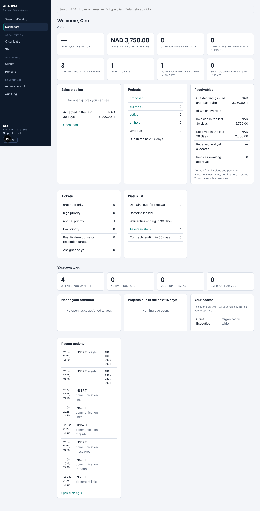

# Dashboard

The first screen after search: an operational picture of ADA for the person looking at it. **Every number is derived at read time** from the authoritative records by one read-only function, `dashboard_summary()` (migration `0046_dashboard.sql`). Nothing is stored, cached or denormalised, no table was added, and no record's identity or content is returned, only counts and sums.

## What it shows

| Block | Figures | Source records |
|---|---|---|
| Sales pipeline | open quotes by status (count and value), accepted in the last 30 days, sent quotes expiring in 14 days, open leads by status | `quotes`, `leads` |
| Projects | live projects by status, overdue, due in 14 days, active by lead division | `projects` |
| Receivables | outstanding (issued and part-paid), of which overdue, invoiced and received in the last 30 days, received but not yet allocated, invoices awaiting approval | `invoices` (balances via `invoice_balance`), `payments`, `payment_balances` |
| Tickets | open by priority, past first-response or resolution target, assigned to you | `tickets`, `ticket_sla_status` |
| Approvals | waiting for a decision (not your own requests), your own requests pending | `approval_requests` |
| Watch list | domains due or lapsed, warranties ending in 30 days, assets by status, contracts ending in 60 days | `domains` / `domain_expiry_status`, `assets` / `asset_warranty_status`, `contracts` |
| Your own work | clients you can see, your tasks, projects due soon, your access, recent audit activity | as before |

Tiles and rows link into Search (`type:… status:…`) so a number is one click from the records behind it.

## Rules it keeps

- **Authorization first.** `dashboard_summary()` is SECURITY INVOKER: the caller's own row-level security decides which rows are counted. A person without finance rights sees empty receivables; a division lead sees their division's invoices but no payments; restricted clients' quotes, invoices, tickets, assets and projects are not in anyone else's numbers. Active staff only: anyone else gets `null`, anonymous is refused.
- **Money is never added across currencies.** Each money figure is one line per currency.
- **Totals equal what you can count yourself.** `113_dashboard.sql` checks, for eight kinds of user, that each dashboard total equals that user's own `count(*)` over the same tables, and that adding a restricted engagement changes nobody's dashboard who cannot see it (byte for byte).
- **Colour carries no meaning alone.** Overdue and past-SLA figures are red and also say "overdue" / "past SLA" in text; the one bar (pipeline value) is a single hue with its figure beside it.

## Not included

Trend lines or history (the figures are "now"), exports, scheduled or e-mailed reports, per-person targets, custom dashboards, and charts beyond the pipeline bar. Those are the Reporting phase.

## Verified

`./scripts/test-db.sh`: all suites and concurrency scripts pass (2,854 checks, of which 12 are `113_dashboard.sql`); the migration rehearsal passes; the live journey (`scripts/pilot-live/run.sh`) opens the dashboard as management (receivables 3,750 outstanding, pipeline, live projects, open tickets) and as a person without finance rights (none of it). Breaking the function's authorization on purpose (SECURITY DEFINER) fails four of the checks.
